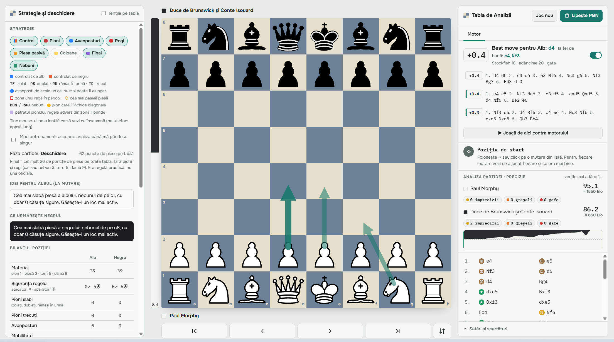

# Chess Analysis Board

A free, unlimited chess game review that runs **entirely in your browser**: paste a game from
chess.com or lichess and **Stockfish 18** (WebAssembly) analyses every move locally. There is no
server, no account and no daily limit.



> The interface is in Romanian (*Tabla de Analiză*). An English UI is planned.

## What it does

- **Game review.** Paste a PGN, choose a depth (quick 10 · normal 13 · deep 16), and every move gets
  classified as best ★, excellent !, good ✓, inaccuracy ?!, mistake ? or blunder ??.
- **Two-pass verification.** Every move flagged as an error is re-checked with a deeper search, so
  shallow-search noise does not mark a good move as a mistake.
- **Accuracy per player**, from the loss in winning chances on each move, using the same curve
  lichess uses (`103.1668 · e^(−0.04354 · loss) − 3.1669`).
- **Live engine** on the position shown, with the top 3 lines (MultiPV 3), selectable depth and
  best-move arrows.
- **Evaluation bar**, move list with coloured classification badges, board flip, keyboard
  navigation (← →) and explanations of what each player should have played.
- **Variations:** play your own moves from any position and go back to the game.
- **PGNs with several games:** pick the one to analyse.
- **Copy FEN** of any position; the last game is remembered between visits (localStorage).
- Light and dark theme, following the system setting.

## Run it

The page has to be served over HTTP: browsers block the WebAssembly engine when the file is opened
directly with `file://`.

**Windows:** double-click `porneste.bat`. It finds Python (a local `.venv` first), picks a free port
from 8000 to 8009 and opens Chrome at `http://localhost:8000`.

**macOS / Linux:**
```bash
./porneste.sh
```

Any static server works too, for example `python -m http.server 8000` or `npx serve`.

It also runs as a static site (for example on GitHub Pages), because everything is plain files.

## Files

| File | What it is |
|---|---|
| `index.html` | the complete app: board, move list, analysis (piece images inlined) |
| `sursa-pagina.html` | the same page without the inlined piece images, easier to read and edit |
| `piese.css` | the piece images (cburnett set) |
| `stockfish.js`, `stockfish.wasm` | Stockfish 18 engine, lite single-threaded build |
| `chess.js` | chess rules and PGN parsing (chess.js 1.4.0) |
| `porneste.bat`, `porneste.sh` | start a local server and open the browser |

Everything works offline; only the web fonts come from Google Fonts, with system fonts as a fallback.

## How it works

- Two Stockfish instances run in **Web Workers** and speak UCI: one for the live analysis of the
  current position (MultiPV 3), one for the full-game review.
- The review evaluates every position, converts centipawns into winning chances and classifies each
  move by how much it lost; flagged moves get a second, deeper pass.
- Game state is a single object; the UI re-renders from it.

## How it was built

Built with **Claude Code** as my main coding tool: I defined what the review should do and how it
should behave, and the AI wrote most of the code under my direction.

## License

**GPL-3.0** (see [LICENSE](LICENSE)), because the project ships Stockfish, which is GPL-3.0.
chess.js is under the BSD 2-Clause license ([LICENSE-chess.js.txt](LICENSE-chess.js.txt)).
The cburnett piece set is by Colin M.L. Burnett (GPLv2+).

**Author:** Mihai Mereu ([github.com/mmereu97](https://github.com/mmereu97))
